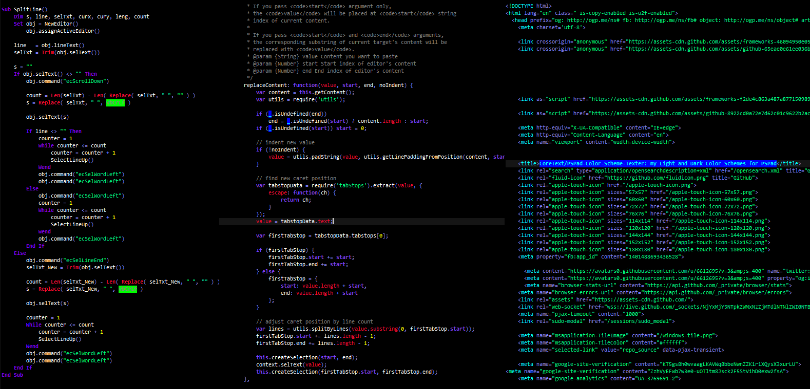
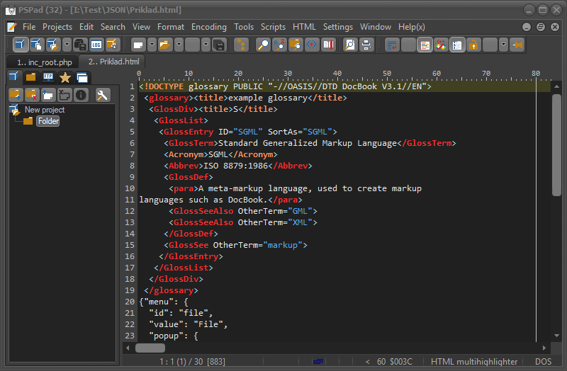

# PSPad Windows Text and Source Code Editor

PSPad is a Windows text and source code editor for programmers and web developers.
It combines syntax highlighting, file tools, code navigation, and portable use in one workspace.

[](https://github.com/pspad-text-editor/pspad-editor/releases/)

## Objectives

PSPad focuses on practical editing rather than a large project framework.
Use it for plain text, source code, web documents, configuration files, and quick file inspection.

The editor can be used as an installed Windows application or as a portable copy.
Keep the chosen mode consistent when sharing settings and editor workflows.

## Feature Overview

| Editing need | PSPad capability | Practical result |
| --- | --- | --- |
| Read source code | Syntax highlighting | Distinguish language elements |
| Navigate code | Code Explorer and folding | Move through structured files |
| Compare files | Difference comparison | Review changes between versions |
| Inspect binary data | HEX editor | Examine bytes directly |
| Work with servers | FTP client | Edit supported remote files |
| Repeat actions | Macro recorder | Reuse recorded editor actions |
| Automate patterns | Templates and auto-completion | Reduce repetitive typing |
| Review compiler output | Output parsing | Jump from messages to source |



## Editing Workspace

A PSPad text editor workspace can contain source code, markup, notes, and configuration files.
Use tabs, search, and navigation tools to keep related work close together.

### A Focused Review Cycle

1. Open the file and identify its encoding.
2. Search for the symbol, phrase, or setting that needs attention.
3. Inspect surrounding lines before making a change.
4. Compare the result with the previous version.
5. Save and reopen the file when encoding matters.

This cycle is useful for both code and ordinary text.
It does not replace a compiler, linter, or application-specific validator.

### Code Navigation

Code folding hides sections while preserving the document structure.
Code Explorer provides a second view for supported languages and file types.

- Collapse repeated or completed sections.
- Use search for names that are not visible in the current view.
- Keep source and generated files in separate folders.
- Review hidden sections before a final save.

## Languages and Web Editing

PSPad supports syntax-aware editing for many programming and markup languages.
The exact highlighting and completion behavior depends on the selected language definition.

Typical use cases include HTML, PHP, Python, JavaScript, C++, SQL, and configuration files.
A language mode changes presentation and editor assistance; it does not validate application behavior.

### Small Markup Example

The following is ordinary HTML content for testing highlighting and indentation.

```html
<!doctype html>
<html lang="en">
  <body>
    <h1>Review this document</h1>
  </body>
</html>
```

Use a small sample when checking a color scheme or a new editor setting.
Keep production documents separate from temporary test content.



## Search and Replace

File Search and Replace helps locate text across selected files.
Before replacing many matches, inspect the search scope and the replacement preview.

### Safer Batch Changes

- Limit the search to the intended directory.
- Use a distinctive search term.
- Check case and whole-word options.
- Review several matches before replacing.
- Keep a backup or version-control checkpoint.
- Reopen representative files after the change.

A broad replacement can modify generated files, backups, or unrelated projects.
Treat the replacement scope as part of the change.

## HEX and Encoding Tools

The integrated HEX editor is useful for inspecting binary files and byte-level content.
Use it carefully because saving a binary file as text can corrupt its structure.

PSPad also supports Unicode and UTF-8 workflows.
Confirm the intended encoding when exchanging files between tools.

### Encoding Review

The following text contains non-ASCII characters for checking a document encoding.

```text
Language: English
Example: café, Ελληνικά, Русский, 日本語
```

Open the sample with the intended encoding and confirm that every character remains readable.
Do not overwrite an important file until the encoding has been verified.

## Macros, Templates, and Completion

Macros can record repeated editor actions.
Templates and auto-completion can reduce repetitive code and document structure.

Review recorded actions before applying them to a broad selection.
A macro that is correct for one document shape may be harmful in another.

### Template Example

This is a neutral text template that can be adapted to a project convention.

```text
Title: ${TITLE}
Owner: ${OWNER}
Status: draft

Notes:
${NOTES}
```

Use the actual placeholder syntax supported by the selected PSPad feature.
The example illustrates content structure, not a guaranteed template variable format.

## Portable Workflow

The portable PSPad edition can run from a removable or shared directory without a traditional installation.
Keep the application and its working data together when moving the editor.

| Portable practice | Reason |
| --- | --- |
| Use a writable directory | Settings and temporary files need space |
| Keep a backup copy | Removable media can fail |
| Check drive letters | Project paths can change |
| Protect saved credentials | Portable media is easy to lose |
| Test on the target machine | Windows policies and fonts differ |

Portable operation changes where files are stored.
It does not make Windows-only editor features available on other operating systems.

## Current Release

The official site lists PSPad version 5.5.3 (895), released on November 2, 2026.
Use the release channel appropriate for the Windows system and editor workflow.

Check the publisher's release notes before replacing an established portable copy.
Keep the previous editor package until the new version has opened representative files correctly.

## Contributing and Support

PSPad is maintained by its developer and supported through its user community.
Useful reports include the editor version, Windows version, file type, encoding, and reproducible steps.

When sharing a sample file, remove credentials and private content.
Describe whether the issue affects editing, comparison, HEX viewing, FTP, or a specific language mode.

## Project Identity and License

PSPad is freeware for Windows.
The creator identified in the supplied brief is Jan Fiala.

Review the publisher's current terms before redistributing the installer, portable package, or extensions.

## Related Search Terms

pspad editor, pspad text editor, pspad code editor, pspad ide, pspad portable, text-editor, source-code-editor, windows, syntax-highlighting, hex-editor, ftp-client, code-folding, macro-recorder, file-comparison
